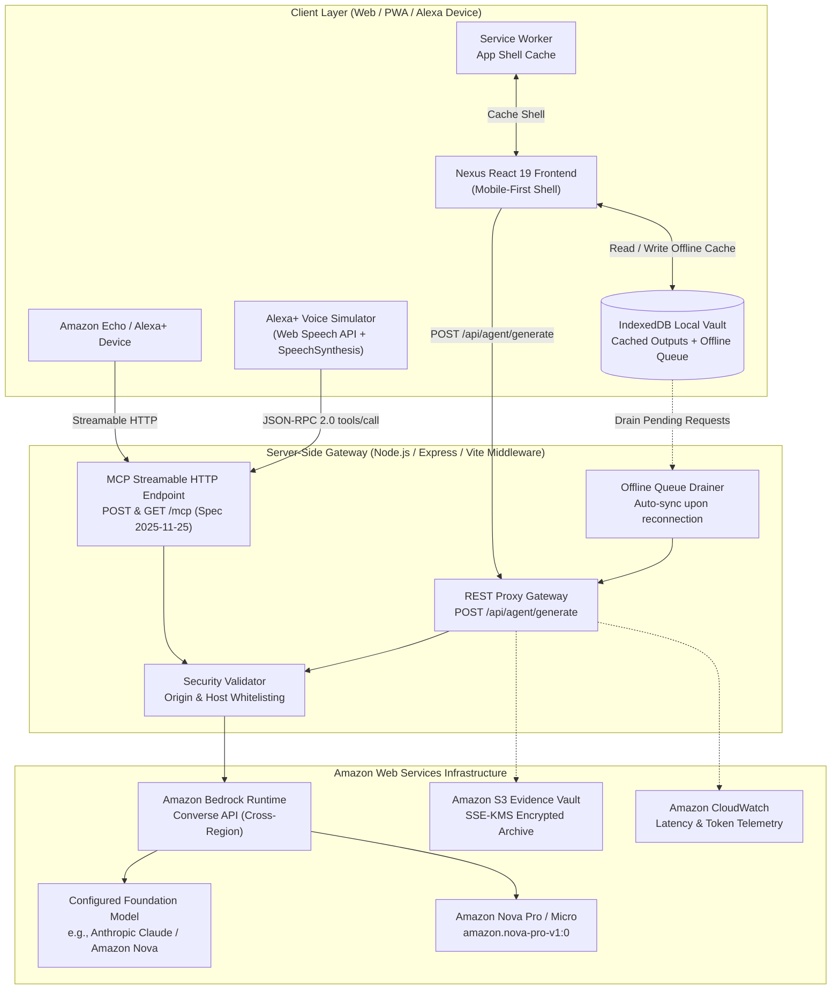

# Nexus Impact AI

> **Specialized Social-Impact AI Workspace Powered by Amazon Bedrock & Model Context Protocol (MCP)**  
> *Submitted to the Amazon Developer Hackathon — Alexa+ Track, AWS Builder Challenge & Open Source Mini Challenge*

[](LICENSE)
[](https://modelcontextprotocol.io)
[](https://aws.amazon.com/bedrock/)
[](#how-to-test-offline-mode)

---

## What Nexus Impact AI Does

Frontline researchers, disaster coordinators, and local community NGOs operate in high-stakes environments where generic consumer chatbots produce superficial generalities and hallucinated operational figures.

**Nexus Impact AI** provides **7 domain-specialized AI agents** grounded in verified international standards:

1. **Research Evidence Synthesizer**: Produces 5-column systematic evidence matrices, PRISMA/Cochrane quality grading, methodological bias critiques, and policy translation protocols.
2. **Humanitarian Emergency Responder**: Calculates strict **Sphere Standards (2018)** allocations (15L potable water/person/day, 20 persons/latrine stall, 3.5m² covered shelter space) with 72-hour operational checklists.
3. **Public Health & Epidemiologist**: Models epidemic growth curves ($R_t$, doubling time), drafts WHO EWARS surveillance profiles, and structures vaccine cold-chain risk assessments (+2°C to +8°C).
4. **Donor Grant Proposal Architect**: Drafts 7-section institutional proposals for USAID (BHA), EU ECHO, and the Global Fund with verifiable 6-column logframes and 5-column risk matrices.
5. **Human Rights & Legal Monitor**: Structures Istanbul Protocol-compliant legal documentation briefs referencing ICCPR, ICESCR, and CEDAW duty-bearer liability.
6. **Maternal & Reproductive Health Specialist**: Formulates clinical Emergency Obstetric (CEmONC/BEmONC) workflows and survivor-centered Clinical Management of Rape (CMR) pathways with 72-hour PEP timelines.
7. **Institutional Knowledge Base & SOP Synthesizer**: Cross-references local field assessments, indicators, and organizational history to extract reusable SOPs.

Every agent output generates both a **voice-friendly short summary** for spoken Alexa+ delivery and a **comprehensive structured report**.

---

## Architecture Diagram



---

## Setup in 5 Commands or Fewer

```bash
# 1. Clone repository
git clone https://github.com/your-username/nexus-impact-ai.git && cd nexus-impact-ai

# 2. Install dependencies
npm install

# 3. Configure environment
cp .env.example .env

# 4. Start development server
npm run dev

# 5. Open browser at http://localhost:3000
```

---

## Environment Variables Table

| Variable | Description | Default | Required? |
|:---|:---|:---:|:---:|
| `UNLOCK_ALL_AGENTS` | Unlocks all 7 Pro agents and bypasses tier paywalls | `true` | Recommended |
| `ALLOW_SIMULATED_RESPONSES` | When false (default), missing/failed Bedrock returns a clear setup error. Must be false for production and judging. If true (testing only), returns answers with a visible SIMULATED badge | `false` | Production: False |
| `BEDROCK_MODEL_ID` | Amazon Bedrock Model or Inference Profile ID (e.g. `us.anthropic.claude-3-5-sonnet-20241022-v2:0`) | `""` | Required for Cloud |
| `AWS_REGION` | AWS Region for Amazon Bedrock API calls | `us-east-1` | Optional |
| `AWS_ACCESS_KEY_ID` | AWS IAM Access Key ID (Server-Side Only) | `""` | Required for Cloud |
| `AWS_SECRET_ACCESS_KEY` | AWS IAM Secret Access Key (Server-Side Only) | `""` | Required for Cloud |
| `RATE_LIMIT_PER_MINUTE` | Per-IP sliding-window rate limit per minute | `10` | Optional |
| `RATE_LIMIT_PER_DAY` | Per-IP sliding-window rate limit per 24h | `60` | Optional |
| `DAILY_REQUEST_CAP` | Global daily request cap across all users | `200` | Optional |
| `MAX_INPUT_LENGTH` | Maximum characters accepted per agent request | `10000` | Optional |
| `MAX_TOKENS_CAP` | Maximum generation tokens per Bedrock Converse call | `2048` | Optional |
| `PORT` | Local web and MCP server port | `3000` | Optional |

> **Security Rule**: AWS credentials are **strictly server-side**. No access keys or secrets are ever bundled or transmitted to the browser client.

---

## Deploy on Render (Production Long-Running Node Host)

Nexus Impact AI includes a production-ready `render.yaml` specification configured for Render web services:

### Option 1: Automatic Blueprint Deployment
1. Push this repository to your GitHub account.
2. In the [Render Dashboard](https://dashboard.render.com), click **New +** &rarr; **Blueprint**.
3. Select your repository. Render automatically reads `render.yaml` and prepares the web service.
4. Fill in your secret environment variables: `AWS_ACCESS_KEY_ID`, `AWS_SECRET_ACCESS_KEY`, and `BEDROCK_MODEL_ID`.
5. Click **Apply**.

### Option 2: Manual Web Service Configuration
If creating a Web Service manually in Render:
- **Environment / Runtime**: `Node`
- **Node Version**: `22` (or set `NODE_VERSION=22`)
- **Build Command**: `npm install --include=dev && npm run build`
- **Start Command**: `npm start` (runs `node server.js`)
- **Health Check Path**: `/api/health`
- **Environment Variables**:
  - `NODE_ENV`: `production`
  - `AWS_REGION`: `us-east-1`
  - `AWS_ACCESS_KEY_ID`: `[Your AWS Access Key ID]`
  - `AWS_SECRET_ACCESS_KEY`: `[Your AWS Secret Access Key]`
  - `BEDROCK_MODEL_ID`: `us.anthropic.claude-3-5-sonnet-20241022-v2:0`
  - `UNLOCK_ALL_AGENTS`: `true`
  - `ALLOW_SIMULATED_RESPONSES`: `false`
  - `MCP_PROTOCOL_VERSION`: `2025-11-25`

Render automatically sets `PORT` and manages TLS/HTTPS certificates. Once deployed, verify your instance by clicking **"Test Connection"** on the Technical Architecture page or opening `/selftest`.

---

## How to Run the Model Context Protocol (MCP) Server

Nexus Impact AI implements the official **Model Context Protocol (MCP) Specification (2025-11-25)** over **Streamable HTTP**:

- **Endpoint**: `POST /mcp` and `GET /mcp`
- **Protocol Handshake**: Returns `text/event-stream` SSE with `event: endpoint` and `event: ready`
- **Header Standard**: Supports `MCP-Protocol-Version: 2025-11-25` and `Mcp-Session-Id`
- **JSON-RPC 2.0 Dispatch**: `initialize`, `ping`, `tools/list`, and `tools/call`

### Test with cURL

```bash
# 1. Initialize MCP Handshake
curl -X POST http://localhost:3000/mcp \
  -H "Content-Type: application/json" \
  -H "MCP-Protocol-Version: 2025-11-25" \
  -d '{"jsonrpc":"2.0","method":"initialize","params":{"protocolVersion":"2025-11-25"},"id":1}'

# 2. List Registered Tools (8 tools returned)
curl -X POST http://localhost:3000/mcp \
  -H "Content-Type: application/json" \
  -H "MCP-Protocol-Version: 2025-11-25" \
  -d '{"jsonrpc":"2.0","method":"tools/list","params":{},"id":2}'

# 3. Call Humanitarian Tool via JSON-RPC 2.0
curl -X POST http://localhost:3000/mcp \
  -H "Content-Type: application/json" \
  -H "MCP-Protocol-Version: 2025-11-25" \
  -d '{"jsonrpc":"2.0","method":"tools/call","params":{"name":"humanitarian_emergency_response","arguments":{"location":"Lower Shabelle, Somalia","population":"18,000"}},"id":3}'
```

### Testing with MCP Inspector (`@modelcontextprotocol/inspector`)

You can test the Streamable HTTP MCP endpoint interactively using the official Model Context Protocol Inspector:

```bash
# Launch MCP Inspector pointing to the local streamable HTTP endpoint
npx @modelcontextprotocol/inspector http://localhost:3000/mcp
```

- **Origin Policy**: External MCP clients (CLI, inspector, Claude Desktop) send no `Origin` header and are accepted.
- **Browser Protection**: Web browser requests sent with an unrecognized `Origin` header are rejected with `403 Forbidden` to prevent cross-site RPC hijacking.

In the web interface, open the **Alexa+** tab to use the built-in microphone simulator and inspect live JSON-RPC 2.0 request/response logs in real time.

---

### AWS Budget & Cloud Cost Protection

To protect against runaway costs when exposing the application or running demonstrations, Nexus Impact AI enforces multiple layers of server-side cost protection:

1. **Per-IP Rate Limiting**: Enforced in memory via sliding windows (`RATE_LIMIT_PER_MINUTE=10`, `RATE_LIMIT_PER_DAY=60`).
2. **Global Daily Request Cap**: Global limit across all users (`DAILY_REQUEST_CAP=200`). This cap applies to both `/api/agent/generate` and `/mcp tools/call`.
3. **Max Input Length**: Inputs exceeding `MAX_INPUT_LENGTH=10000` characters are rejected with a 400 error.
4. **Token Generation Cap**: Bedrock `ConverseCommand` calls are capped at `MAX_TOKENS_CAP=2048` tokens.
5. **Request Timeouts**: Calls to Bedrock are aborted after `REQUEST_TIMEOUT_MS=25000` (25 seconds).

#### Setting Up an AWS Budget Alert

We strongly recommend creating a zero-cost AWS Budget alert in your AWS account:

1. Open the **AWS Billing and Cost Management Console** &rarr; **Budgets**.
2. Click **Create budget** &rarr; Select **Cost budget (Recommended)**.
3. Set your monthly target (e.g. **$10.00 USD**).
4. Configure an alert threshold at **80% of actual spend** and **100% of forecasted spend**.
5. Add your email address or an Amazon SNS topic to receive instant email notifications if Bedrock usage approaches your threshold.

---

## Running Automated Tests & Linting

```bash
# 1. Run MCP protocol conformance, PII redaction, AES-GCM encryption & safety guardrails tests
npm run test:mcp

# 2. Type check and code validation
npm run lint

# 3. Production build verification
npm run build
```

---

## Crisis & Displacement Settings: Privacy By Design

Engineered specifically for IDPs, refugees, host communities, and frontline responders in low-connectivity zones of sub-Saharan Africa:
- **Anonymous Use**: Zero accounts, zero login, zero tracking, zero third-party analytics scripts.
- **Prompt Privacy**: This application does not log prompt text; Render and AWS maintain standard infrastructure and network logs.
- **Client-Side PII Redaction**: Phone numbers, emails, UNHCR/national IDs, GPS coordinates, and victim names are scrubbed before any cloud call.
- **On-Device AES-GCM 256-Bit Encryption**: Optional user passphrase protects local IndexedDB vault records using the browser Web Crypto API.
- **Quick Exit / Panic Wipe**: Instant data erase button on every screen + `Esc` pressed 3 times clears IndexedDB, caches, and localStorage, redirecting to a neutral site.
- **11 Languages Supported**: English, Arabic (RTL), French, Portuguese, Swahili, Amharic, Tigrinya, Oromo, Somali, Hausa, and Kinyarwanda with device auto-detection and honest on-device vocabulary warnings.
- **Offline Sharing**: Transfer field outputs without internet via scannable on-device QR codes, print-friendly views, or Markdown exports.

---

## How to Test Offline Mode (Judge Walkthrough)

Humanitarian responders and epidemiologists frequently operate in conflict corridors or disaster zones with zero internet access. Nexus Impact AI operates genuinely offline:

1. In the top header bar, click the **Online** pill. It immediately switches to **Offline Mode** with an amber indicator.
2. Select any agent (e.g., *Humanitarian Emergency Response* or *Public Health*).
3. Click **"Run Sample Scenario Now (<30s Result)"**.
4. Observe the response:
   - Notice the badge explicitly says: `On-device (offline, lower accuracy)`.
   - The output is grounded in the bundled **Offline Knowledge Pack** (Sphere Handbook 2018, WHO Field Protocols) with open-license citations.
   - The request is automatically queued in local **IndexedDB**.
5. Click the **Vault** icon in the header toolbar to view your saved offline outputs and see `1 queued` in the Sync Queue.
6. Click the header badge to switch back to **Online**, then click **"Re-run with Cloud (Bedrock)"** in the vault to upgrade your output with live cloud inference!

---

## License

Licensed under the [MIT License](LICENSE).
